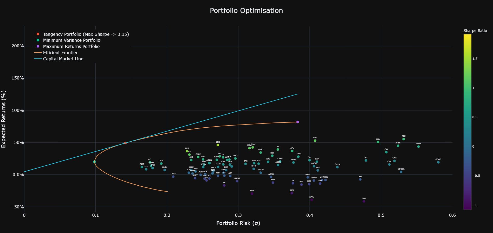
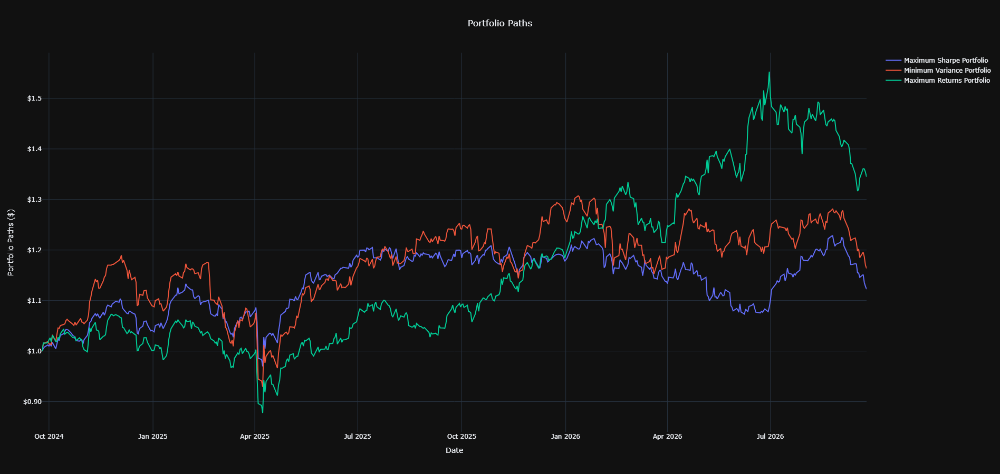

<h1 align="center">Portfolio Optimisation</h1>

  
   
  </b> Resulting portfolios visualised in expected returns - risk space. Optimisation is performed on three different objective functions; minimum variance, maximum returns and maximum Sharpe ratio, following the procedure outlined below on various U.S equities. Each objective presents a convex function to optimised, solved using Sequential Least Squares Programming (SLSQP) methods within Python.

### 1. Expected Portfolio Return

The expected portfolio return is:

$$
\mathbb{E}[R_p] = \boldsymbol{w}^\top \boldsymbol{\mu}
= \sum_{i=1}^{n} w_i \mu_i
$$

where:

- $w_i$ is the proportion of capital allocated to asset $i$.
- $\mu_i$ is the expected return of asset $i$.
- $n$ is the number of assets.

For historical daily returns, the expected returns can be estimated using the sample mean and annualised:

$$
\boldsymbol{\mu}_{\text{annual}}
= 252 \cdot \boldsymbol{\mu}_{\text{daily}}
$$

assuming 252 trading days per year.

### 2. Portfolio Variance and Volatility

Let $\Sigma$ be the covariance matrix of asset returns. Portfolio variance is:

$$
\sigma_p^2 = \boldsymbol{w}^\top
\boldsymbol{\Sigma}\boldsymbol{w}
$$

Portfolio volatility is the square root of variance:

$$
\sigma_p = \sqrt{\boldsymbol{w}^\top
\boldsymbol{\Sigma}\boldsymbol{w}}
$$

Using historical daily returns, annualised covariance is estimated as:

$$
\boldsymbol{\Sigma}_{\text{annual}}
= 252 \cdot \boldsymbol{\Sigma}_{\text{daily}}
$$

### 3. Portfolio Optimisation Constraints

Portfolio weights are subject to the following constraints:

$$
\sum_{i=1}^{n} w_i = 1
$$

$$
0 \leq w_i \leq w_{\max}
\qquad \forall i
$$

$w_{\max}$ here is set to a maximum of 10% capital allocation to mitigate extreme allocations to one asset.

### 4. Portfolio Optimisation Objectives

#### 4.1 Maximum Sharpe Ratio

Let $r_f$ be the risk-free rate.

$$
S(\boldsymbol{w}) =
\frac{\boldsymbol{w}^\top\boldsymbol{\mu} - r_f}
{\sqrt{\boldsymbol{w}^\top
\boldsymbol{\Sigma}\boldsymbol{w}}}
$$

The maximum Sharpe ratio portfolio is obtained by solving:

$$
\boxed{
\max_{\boldsymbol{w}}\
\frac{\boldsymbol{w}^\top\boldsymbol{\mu} - r_f}
{\sqrt{\boldsymbol{w}^\top
\boldsymbol{\Sigma}\boldsymbol{w}}}
}
$$

This objective identifies the portfolio offering the highest expected excess return per unit of risk.

#### 4.2 Minimum Variance

The minimum variance portfolio minimises total portfolio risk:

$$
\boxed{
\min_{\boldsymbol{w}}\
\boldsymbol{w}^\top
\boldsymbol{\Sigma}\boldsymbol{w}
}
$$

This objective prioritises the minimisation of portfolio risk rather than higher returns.

#### 4.3 Maximum Expected Return

The maximum expected return portfolio solves:

$$
\boxed{
\max_{\boldsymbol{w}} \quad
\boldsymbol{w}^{\top}\boldsymbol{\mu}
}
$$

This objective aims to find the weights that maximise expected returns.

<h1 align="center">Theoretical Paths</h1>

The following plot displays the theoretical wealth paths for the optimised portfolio under the different objective functions in retrospect (likely to fail out of sample due to overfitting, ill-conditioned covariance matrix makes optimised results highly dependent to sampled period).

  

